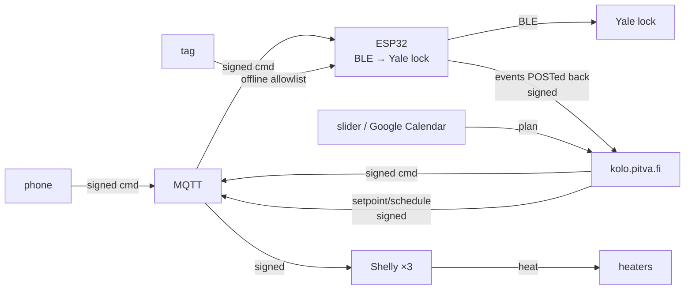

# Kolo

`kolo.pitva.fi` — the Vercel web app that controls the PitVa kolo **front door**
and **electric heating**. It is the "policy, logs and UI" layer the two plans in
[`suunnitelmat/`](suunnitelmat/) describe ([PLAN.md](suunnitelmat/PLAN.md) door,
[HEATING.md](suunnitelmat/HEATING.md) heating); the devices and firmware
(ESP32 + PN532 reader, heating Shellys, MQTT broker) are separate and mostly
not built yet.

Sign-in is the shared `atk.pitva.fi` Google login (same cookie as klapi/budu).
**Authorisation is Google Group membership** — a member of `ACCESS_GROUP` can
open the door and set the heating; nobody else can. There is no user database.

## How it fits together



The broker is untrusted and only relays: **every command is HMAC-SHA256 signed**
([`lib/sign.ts`](lib/sign.ts)) and every device report verified the same way,
with timestamp-skew and single-use-nonce replay protection.

## Routes

| Route | What |
|---|---|
| `POST /api/unlock` · `/api/lock` | member → signed command → wait for ack → log |
| `GET /api/status` | last door state (locked / open / battery) |
| `GET /api/heating` · `POST /api/heating/setpoint` | setpoint + room temps; slider override |
| `POST /api/state` · `/api/log` | device reports state / door events (signed) |
| `GET/POST/DELETE /api/tags…` · `POST /api/tags/enroll` | tag admin + on-reader enrol |
| `POST /api/allowlist` | push the signed tag allowlist to the reader |
| `GET /api/cron/{heating,allowlist,heartbeat}` | Vercel Cron (see `vercel.json`) |

## Develop

```bash
npm install
cp .env.example .env            # fill in at least NEXTAUTH_SECRET + DATABASE_URL
npx prisma migrate dev          # create the schema
ENABLE_DEV_LOGIN=true npm run dev
npm test                        # pure-logic checks (signing, heating maths)
```

With `MQTT_URL` unset, the door/heating commands return a clear "transport not
configured" instead of pretending to work — nothing fakes a successful unlock.

## Status

The web app is complete; the on-site hardware is the next step, in the phase
order the plans lay out (offline key → ESP32 BLE spike → reader; one Shelly +
sensor → the rest → calendar). The signing contract here is what the firmware
and Shelly scripts implement against.
