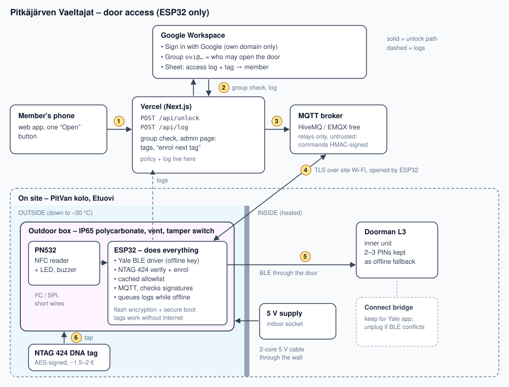

# Door access via Google accounts — plan

Goal: stop handing out Yale PIN codes (max 30 slots) for the PitVan kolo front
door (`Etuovi`, a **Yale Doorman L3**). Instead, anyone in a Google Workspace
group can open the door from their phone or with a personal NFC tag. Access is
granted and revoked by editing group membership — nothing on the lock itself.



Status (Oct 2026): planning. Decided: local Bluetooth, ESP32-only as the main
path, Raspberry Pi 5 + Home Assistant as fallback, cloud (Lightsail) as last
resort.

Current usage for reference (30 days of `yale_activity_full.csv`, Mar–Apr
2026): 37 PIN unlocks, 66 manual (inside) unlocks, mostly weekday evenings.

## Site facts

Door building only. The heating project ([HEATING.md](HEATING.md)) is a
**separate building with no internet**.

- ✅ Yale Connect bridge installed.
- ✅ Mains socket and Wi-Fi at the door.
- ✅ Inside is heated; outside goes down to ~–30 °C.

## Architecture (ESP32 only)

```
tag   ─► [PN532 + ESP32, one box outside] ─BLE through the door─► Doorman L3
phone ─► Vercel ─► MQTT broker ◄─TLS, opened by ESP32─ ESP32 ─BLE─► lock
```

- **Yale has no public API.** Locally the lock speaks the August/Yale BLE
  protocol; anyone holding the lock's **offline key + slot** can lock/unlock it
  directly, no Yale cloud involved.
- **ESP32 does everything on site:** BLE to the lock, NTAG 424 tag checks,
  cached allowlist, MQTT client, log queue. Tags work without
  internet.
- **Vercel is where policy and logs live:** Google sign-in, group check, tag
  admin, log sheet.
- **Yale's own log will not show who opened** (only the key/slot used), so the
  Vercel log is the real audit trail.

### Offline key

- Doorman L3 is not on HA's official Yale Access Bluetooth list, but works over
  BLE per community reports (lock, unlock, door state; doorbell events don't).
- Fetch once from the Yale cloud: a small `yalexs` script in this repo (we
  already have token handling in `export_yale_oauth.py`) reading the lock
  detail's offline key, slot and MAC. Alternatively let HA's Yale integration
  provision it and read it from `.storage/core.config_entries`.
- **Use a dedicated Yale owner account for this** (e.g. `ha@<domain>`), never
  logged into the Yale Home app — app logins can rotate the key and break BLE.
- If keys don't sync, HA docs: may need a fresh owner-level account invited to
  the lock to force it.

### ESP32 firmware

`yalexs-ble` itself is Python (built on `bleak`) and cannot run on the ESP32 —
the chip can do the protocol (BLE central + hardware AES), but the library
can't. So base on an existing **C++** port of the handshake, don't rewrite the
protocol:
- [marcusadolfsson/apple-homekey-yale](https://github.com/marcusadolfsson/apple-homekey-yale)
  — ESP32-C6, PN532, C++ Yale BLE driver (offline-key handshake, unlock).
  Closest to this design; also offers Apple Home Key tap-to-unlock.
- [splitice/esphome-yale-smartlock](https://github.com/splitice/esphome-yale-smartlock)
  — ESPHome external component, lock/unlock/door/battery, manual credentials.

**One ESP32 controller for everything** (BLE, Wi-Fi/MQTT, tags). Watch RAM:
TLS + BLE + Wi-Fi on one chip is tight without PSRAM. If the C6 runs out of
memory, use an ESP32-S3 with PSRAM (port the BLE driver) — still one board.

Our additions:
- NTAG 424 DNA SUN check: AES decrypt PICC data → UID + counter, AES-CMAC
  verify (mbedTLS has both), counter must increase (stored in NVS).
- Per-tag keys diversified from a master key + UID.
- Allowlist cached in NVS (UID → member id), replaced whenever Vercel pushes a
  new one; tags keep working offline with the last list.
- MQTT over TLS to the broker; accepts only commands HMAC-SHA256-signed by
  Vercel with timestamp (±30 s) and nonce (no replays).
- Enrol mode: on a signed "enrol next tag for X" command, the next blank tap is
  programmed (keys + SDM settings) and reported back. No separate programmer.
- Log queue in flash, flushed to Vercel when online.
- Flash encryption enabled (offline key, master key and HMAC key live there).
- Signed OTA updates triggered from Vercel.

### Vercel web app

- Next.js + Auth.js (Google provider). Sign-in restricted to the Workspace
  domain (`hd` claim checked server-side).
- Authorisation = membership in Google Group `ovi@<domain>` (name TBD), checked
  via Admin SDK Directory API (`members.hasMember`) with a service account with
  domain-wide delegation, scope `admin.directory.group.member.readonly`.
- `POST /api/unlock` (and `/api/lock`): session + group → publish signed
  command → wait ≤5 s for the ESP32 ack → log → "opened"/"failed".
- `GET /api/status`: last reported lock/door/battery state.
- `POST /api/log`: from the ESP32 (HMAC-signed).
- Admin page: tag list (UID → member), "enrol next tag", revoke, push allowlist.
  Group changes → allowlist re-pushed (cron every few minutes + on admin edits).
- Log: Google Sheet `Door log` (time, member, phone/tag, result)
  via the same service account. Readable by the board.
- UI: one big button with confirmation, status line, add-to-home-screen.
- Rate limit per user; denied attempts are logged too.
- Vercel Hobby is free but terms say personal/non-commercial — an association
  is a grey area; Pro is 20 $/mo if it matters.

### MQTT broker

- Managed free tier: HiveMQ Cloud Serverless or EMQX Serverless. Zero upkeep.
- Treated as untrusted: it only relays. Every command is signed (see above),
  so a compromised broker account can't open the door.
- Alternative: Mosquitto on the existing Lightsail (0 € extra, but upkeep).
- Polling Vercel instead of MQTT is possible but adds ~1 s lag and eats into
  Hobby request limits.

## NFC tags and reader

### Tags

| Tag | Price | Clone-resistant? | Verdict |
|---|---|---|---|
| 125 kHz EM4100 / T5577 | ~0.2 € | No — copied in seconds with a 10 € cloner | avoid |
| MIFARE Classic 1K | ~0.3 € | No — crypto broken, magic clone cards cheap | avoid |
| NTAG213/215 (UID only) | ~0.3 € | No — UID can be emulated | avoid |
| **NTAG 424 DNA** | **~1.5–2 €** | **Yes — AES-128, every tap gives a fresh signed message + counter (SUN)** | **use** |
| MIFARE DESFire EV2/EV3 | ~2–4 € | Yes, but needs mutual auth | more work, no gain |

The tag is only a pointer to a person; removing them from the Google Group
removes the tag from the next allowlist push.

### Reader and mounting

- **PN532 module** (Elechouse V3 or clone): supports ISO-DEP, needed for
  NTAG 424. RC522 is cheaper but poor at ISO-DEP.
- PN532 reads through only ~1–2 cm, so it must be outside. **ESP32 goes in the
  same outdoor box**: short wires (I²C/SPI fine), no data cable through the
  wall.
- Box: sealed polycarbonate IP65 (not metal — it would block NFC, BLE and
  Wi-Fi), breather vent against condensation, conformal-coated boards, cable
  gland. Green/red LED + buzzer for instant feedback.
- **Power stays inside**: USB supplies are rated 0…40 °C. Run 5 V over a 2-core
  outdoor cable through the frame/wall (or use a –40 °C rated DIN-rail supply).
  The ESP32 + PN532's own few hundred mW keeps the box slightly above ambient.
- Ratings: ESP32 module –40…+85 °C, PN532 chip –30…+85 °C. Cheap dev boards
  (regulator, USB chip, capacitors) may be worse — leave the pilot outside for
  a cold night first; a board with an industrial-rated module is worth it.
- **Radio through the door:** BLE must reach the lock's inner unit and Wi-Fi
  the router from outside. Fine through wood; a metal-skinned door or frame
  can block it — measure RSSI from the mounting spot before drilling.
- **Physical attack:** the box is reachable by anyone. Unlocking is over BLE,
  not a wire, so prying the box open does not open the door. Keys live in
  encrypted flash: enable **flash encryption + secure boot** so a stolen board
  doesn't leak the offline key. Add a tamper switch → alert via Vercel. If a
  board is stolen anyway: remove the Yale user/slot and re-fetch a new offline
  key, rotate the tag master key.

## Fallback: Raspberry Pi 5 + Home Assistant

If the ESP32 BLE port is unreliable:
- Pi 5 (onboard Wi-Fi + BT) inside near the door, HA OS, official **Yale
  Access Bluetooth** integration with the offline key, passive case,
  HA backups to Google Drive.
- Vercel reaches HA via Tailscale Funnel (free, `*.ts.net`, no open ports)
  using a non-admin HA user's long-lived token.
- ESP32 stays outside as the tag reader and calls a local HA webhook to unlock.
- HA Green is not an option at the door: no Wi-Fi or Bluetooth.

Last resort (no on-site computer): HA on the existing AWS Lightsail + Caddy,
Yale cloud + Connect bridge for unlocking. Works, but depends on Yale cloud and
is slower; see git history (`e2d2682`) for the full write-up.

## Shopping list

Rough Finnish/EU retail estimates (Oct 2026); AliExpress cheaper but slower.

**Phase A — ESP32 BLE spike (~25 €)**

| Item | Qty | ~€ | Note |
|---|---|---|---|
| ESP32-C6 dev board | 2 | 20 | one to test, one spare |
| USB power supply + cable | 1 | 5–10 | |

**Phase B — reader pilot (~75 €)**

| Item | Qty | ~€ | Note |
|---|---|---|---|
| PN532 NFC module V3 | 1 | 10 | |
| NTAG 424 DNA key fobs | 5 | 10 | pilot batch |
| LED (green/red) + piezo buzzer + jumper wires | 1 set | 8 | |
| Polycarbonate IP65 box + breather vent + cable gland | 1 | 20 | |
| Conformal coating spray | 1 | 12 | |
| 2-core outdoor cable, ~3 m | 1 | 5 | 5 V from the supply inside |
| Tamper microswitch | 1 | 2 | box-open alert |

**Phase C — rollout (~40–60 €)**

| Item | Qty | ~€ | Note |
|---|---|---|---|
| NTAG 424 DNA key fobs | 25 | 40–60 | ~1.5–2.5 € each |

**Total: ~150 €. Running cost 0 €.**
No tag programmer needed — the PN532 enrols tags on site.
Fallback adds Raspberry Pi 5 4 GB + PSU + passive case + high-endurance
microSD ≈ 110 €.

## Failure modes

| Fails | Phone | Tag | Mitigation |
|---|---|---|---|
| Site internet | ✗ | ✓ (cached allowlist) | logs queued |
| MQTT broker / Vercel / Google | ✗ | ✓ | PIN fallback |
| ESP32 | ✗ | ✗ | 2–3 PINs for leaders; spare board |
| Box stolen / vandalised | ✗ | ✗ | PINs; flash encryption; rotate offline key + tag key |
| Offline key rotated | ✗ | ✗ | dedicated owner account; re-fetch script |
| BLE contention with Connect bridge | flaky | flaky | test; unplug bridge if needed |
| Power cut | ✗ | ✗ | lock runs on batteries: PIN + key still work |
| Lock batteries | — | — | lithium AAs if needed; battery level in status |

## Phases

1. **Offline key.** Create dedicated Yale owner account, invite to the lock,
   write `yalexs` script to fetch key/slot/MAC.
2. **ESP32 BLE spike.** Flash `apple-homekey-yale` (or the ESPHome component),
   100 lock/unlock cycles with the bridge plugged in, measure latency and
   failures, check lock battery after a week. Go/no-go for ESP32-only.
3. **Vercel + MQTT.** Google sign-in, group check, signed commands, ack, Sheet
   log. Pilot with leaders for ~2 weeks.
4. **Reader.** ESP32 + PN532 outside, NTAG 424 verify + enrol, allowlist push.
   Cold-night test. Roll out tags, cut PINs to 2–3 fallback codes.

## Open questions

- Workspace domain + group name; who administers the group and tags.
- Door material: does BLE/Wi-Fi get through from the outside mounting spot?
- Time-limited access (e.g. only meeting evenings)? Easy in the Vercel policy,
  skipped until asked for.

## Sources

- HA Yale integration: https://www.home-assistant.io/integrations/yale
- HA Yale Access Bluetooth: https://www.home-assistant.io/integrations/yalexs_ble
- yalexs-ble: https://github.com/Yale-Libs/yalexs-ble
- Doorman L3 over BLE (blog): https://www.henriksommerfeld.se/yale-doorman-l3-with-home-assistant-through-bluetooth-proxy/
- ESP32 Yale BLE + PN532: https://github.com/marcusadolfsson/apple-homekey-yale
- ESPHome Yale component: https://github.com/splitice/esphome-yale-smartlock
- Yale Zigbee module (not for L3): https://community.home-assistant.io/t/yale-doorman-zigbee-module/1004348
